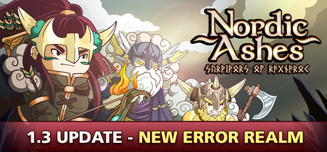

**Nordic Ashes: Survivors of Ragnarok is a Norse mythology-themed survivor-like roguelite where you choose a Viking hero and fight through escalating hordes in auto-combat runs. Features a deity boon system and permanent rune upgrades between runs.**

---

## 📖 About

Nordic Ashes: Survivors of Ragnarok is a Norse mythology-themed survivor-like roguelite where you choose a Viking hero and fight through escalating hordes in auto-combat runs. Features a deity boon system and permanent rune upgrades between runs.

## ⚠️ Problems Without Trainer

| Problem | Status |
|---------|--------|
| **Early Rune Scarcity** — Starting runs feel underpowered before permanent upgrades accumulate | ✅ Solved |
| **Deity Boon Choices** — Choosing wrong boons for your hero creates ineffective build paths | ✅ Solved |
| **Boss Scaling** — World bosses dramatically escalate difficulty for underprepared builds | ✅ Solved |
| **Ragnarok Finale** — Final wave events require very specific build compositions to survive | ✅ Solved |

## ✅ Solution

The **Nordic Ashes: Survivors of Ragnarok Trainer** solves all these issues by giving you complete control over the game.

## 🎯 Full Feature List

- Unlimited Resources
- God Mode / Invincibility
- Instant Skill Cooldown
- One-Hit Kill
- Freeze Game Timer
- Unlock All Items & Achievements
- Custom Speed Multiplier
- Save State Anywhere

## 🚀 Quick Start

1. **Disable Windows Defender** temporarily (trainer may trigger false positive)
2. Download the trainer from the button above
3. Launch Nordic Ashes: Survivors of Ragnarok
4. Run the trainer as Administrator
5. Activate desired cheats with hotkeys

## 💎 Free vs Paid

| Feature | Free | Pro |
|---------|------|-----|
| Basic God Mode | ✅ | ✅ |
| Unlimited Resources | ✅ | ✅ |
| All Advanced Cheats | ❌ | ✅ |
| Auto-Updates | ❌ | ✅ |
| Priority Support | ❌ | ✅ |

## 💻 Requirements

- Windows 10/11 (64-bit)
- Nordic Ashes: Survivors of Ragnarok (any version)
- .NET Framework 4.8+
- DirectX 11+

## 🍎 macOS

macOS users can use our alternative tool:

## ⚖️ Legal

This trainer is for educational and single-player use only. Use responsibly.

---

